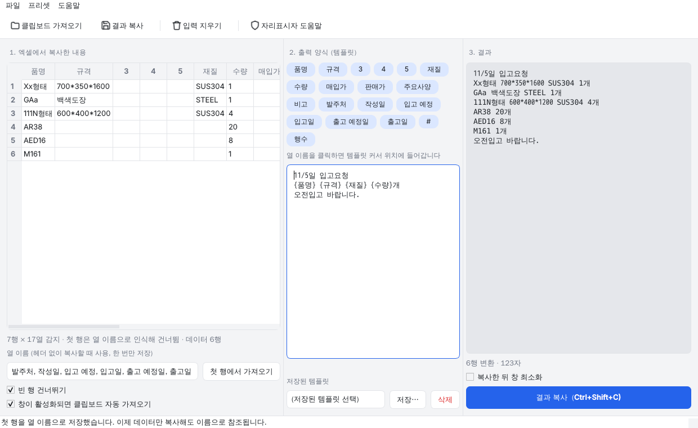
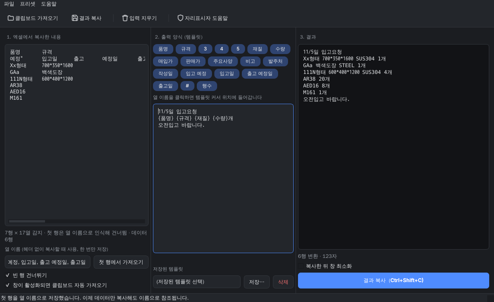

# PDF Masker

PDF에서 가릴 부분을 드래그로 지정하거나 자동으로 찾아, **복구할 수 없게** 지운 뒤 새 파일로 저장하는 Windows·macOS 데스크톱 앱입니다.
모든 처리는 내 컴퓨터 안에서만 이루어지며 파일이 외부로 전송되지 않습니다.

| 라이트 | 다크 |
| --- | --- |
|  |  |

## 기능

- 마우스 드래그로 가릴 영역 지정, 클릭으로 선택, `Delete`로 삭제
- 주민번호 · 전화번호 · 이메일 · 카드번호 **자동 탐지** → 후보 목록에서 확인 후 추가
  - 텍스트 PDF는 글자 데이터에서, **스캔 PDF는 OS 내장 OCR**(macOS Vision / Windows OCR)로 읽습니다. 외부 엔진 없음, 네트워크 사용 없음
- 페이지 썸네일 사이드바 (마스킹 영역 수 배지 표시)
- 확대/축소 (`Ctrl` + `+`/`-`, `Ctrl`+휠), 폭 맞춤 (`Ctrl+0`)
- PDF 파일 드래그 앤 드롭으로 열기, 파일 연결로 실행 가능
- 시스템 라이트/다크 모드 자동 연동
- 암호 걸린 PDF 열기 지원 (결과는 암호 없이 저장)

## 다운로드 / 설치

GitHub Actions가 자동으로 빌드합니다. 저장소의 **Actions** 탭 → 최근 실행 → **Artifacts** 에서 앱별로 따로 받거나
(`PDF-Masker-windows`, `Excel-Paster-windows`, macOS 는 `-macos-arm64`), `v1.0.0` 같은 태그를 푸시하면 **Releases** 에 올라갑니다.
각 zip 에는 실행 파일과 `SHA256SUMS.txt` 가 들어 있습니다.

| 파일 | 대상 |
| --- | --- |
| `PDF-Masker-windows.exe` | Windows 10/11 (64비트) — 설치 없이 바로 실행 |
| `PDF-Masker-macos-arm64.dmg` | Mac (Apple Silicon, M1 이후) |
| `Excel-Paster-windows.exe` | [Excel Paster](#excel-paster) Windows용 — 설치 없이 바로 실행 |
| `Excel-Paster-macos-arm64.dmg` | Excel Paster Mac용 |

> **처음 실행 시 경고가 뜨는 이유**
> 개발자 서명 인증서(Apple $99/년, Windows 코드사인)를 쓰지 않아 OS가 "확인되지 않은 앱"으로 경고합니다.
> - **macOS**: 앱을 우클릭 → **열기** → 열기. (또는 시스템 설정 → 개인정보 보호 및 보안 → "그래도 열기")
> - **Windows**: SmartScreen 창에서 **추가 정보** → **실행**.
>
> 서명 인증서가 있다면 `.github/workflows/build.yml` 의 패키징 단계에 서명을 추가하면 됩니다.

**빌드 신뢰성**: 모든 실행 파일은 GitHub 가 제공하는 깨끗한 가상머신에서 이 저장소의 소스만으로 빌드됩니다.
빌드마다 포함되는 패키지 전체를 `pip-audit` 로 알려진 취약점 점검을 하고(발견 시 빌드 실패), 산출물의 SHA-256 체크섬을
`SHA256SUMS-*.txt` 로 함께 올립니다. Actions 실행 페이지의 Summary 에서 파일 크기와 체크섬을 바로 볼 수 있습니다.
받은 파일은 Windows 에서 `certutil -hashfile 파일.exe SHA256`, macOS 에서 `shasum -a 256 파일.dmg` 로 대조하면 됩니다.

## 사용법

1. PDF를 창에 끌어다 놓거나 `Ctrl+O`로 엽니다.
2. 가릴 부분을 드래그하거나, **자동 탐지**(`Ctrl+F`)로 찾은 후보를 확인하고 추가합니다. 영역을 클릭해 선택하고 `Delete`로 지울 수 있습니다.
3. `Ctrl+S`로 저장합니다. 원본은 그대로 두고 `_masked.pdf`가 새로 생깁니다.

## 복구 불가 처리 방식

단순히 검은 상자를 "덮는" 것이 아니라 내용을 **실제로 제거**합니다.

- 영역과 겹치는 텍스트 글자 삭제
- 스캔 PDF는 영역과 겹치는 이미지 픽셀 삭제
- 영역과 닿는 벡터 선/도형, 링크 제거
- 영역과 겹치는 폼 필드(입력값 포함), 주석(메모 내용 포함) 제거
- 메타데이터, 첨부파일, 숨은 텍스트 정리, 이전 리비전 제거 (증분 저장 미사용)
- 회전된 페이지(스캔본에 흔함)도 화면에서 보이는 위치 그대로 가려짐
- 옵션 "모든 페이지를 이미지로 변환": 텍스트 레이어를 통째로 없앰 (가장 안전, 검색 불가)

## 한계 · 주의

- 자동 탐지는 정규식 기반이라 놓치거나 잘못 잡을 수 있습니다. 후보 목록을 반드시 확인하세요.
- **스캔 PDF의 OCR**
  - macOS: 13 이상에서 한국어 인식. 별도 설치 없음.
  - Windows: 10/11 내장 OCR을 쓰며 **한국어 언어 팩**이 필요합니다. 설정 → 시간 및 언어 → 언어 및 지역 → 한국어 → 언어 옵션에서 "광학 문자 인식"이 설치되어 있어야 합니다. (한국어 Windows는 보통 이미 설치됨)
  - OCR 인식률은 스캔 품질에 좌우됩니다. 흐리거나 기울어진 스캔은 놓칠 수 있으니 결과를 확인하세요.
- 영역에 조금이라도 걸친 글자는 통째로 지워집니다. 저장 결과를 육안으로 확인하세요.

## 개발

```bash
python3 -m venv .venv
source .venv/bin/activate        # Windows: .venv\Scripts\activate
pip install -r requirements.txt
python main.py                   # PDF Masker 실행
python paster_main.py            # Excel Paster 실행
pytest -q                        # 테스트
```

### 로컬 빌드

- macOS: `scripts/build.sh` → `dist/PDF Masker.app`, `dist/Excel Paster.app`
- Windows: `scripts\build.bat` → `dist\PDF Masker.exe`, `dist\Excel Paster.exe`

### 구조

| 경로 | 역할 |
| --- | --- |
| `masker/core.py` | 마스킹 로직 (좌표 변환, 복구 불가 처리). GUI 없이 테스트 가능 |
| `masker/detect.py` | 개인정보 패턴 자동 탐지 (텍스트 / OCR 공통) |
| `masker/ocr.py` | OS 내장 OCR 백엔드 (macOS Vision, Windows.Media.Ocr) |
| `masker/gui.py` | PySide6 데스크톱 UI |
| `masker/theme.py` | 라이트/다크 테마 토큰, 스타일시트, 아이콘 (두 앱이 공유) |
| `excelpaster/core.py` | 엑셀 클립보드 파싱, 템플릿·필터 변환, 프리셋 직렬화. GUI 없이 테스트 가능 |
| `excelpaster/gui.py` | Excel Paster PySide6 UI |
| `tests/` | 핵심 로직 테스트 (`test_core.py`·`test_detect.py` PDF Masker, `test_paster.py` Excel Paster) |
| `pdfmasker.spec`, `excelpaster.spec` | PyInstaller 빌드 스펙 |
| `scripts/pyi_trim.py` | 번들에서 쓰지 않는 Qt 모듈·플러그인·번역을 걸러내 실행 파일 크기 축소 |
| `.github/workflows/build.yml` | Windows/macOS 자동 빌드 및 릴리스 |

---

# Excel Paster

엑셀에서 셀 범위를 복사해 붙여넣으면, 내가 글로 적어 둔 **템플릿** 대로 바꿔 주는 Windows·macOS 데스크톱 앱입니다.
명단을 메신저에 올리거나, 표를 문장으로 풀어 쓸 때 씁니다. PDF Masker 와 마찬가지로 모든 처리는 내 컴퓨터 안에서만 이루어집니다.

| 라이트 | 다크 |
| --- | --- |
|  |  |

## 사용법

1. 엑셀에서 원하는 셀 범위를 복사합니다 (`Ctrl+C`).
2. Excel Paster 창으로 오면 자동으로 입력칸에 들어갑니다. (자동 가져오기를 끈 경우 입력칸에 `Ctrl+V` 또는 툴바의 **클립보드 가져오기**)
3. 가운데 템플릿 칸에 원하는 양식을 글로 적습니다. 결과는 오른쪽에 바로 나타납니다.
4. **결과 복사** (`Ctrl+Shift+C`) 를 누른 뒤 원하는 곳에 `Ctrl+V` 합니다.

## 템플릿

원하는 결과를 그대로 적되, 셀 값이 들어갈 자리에 `{열이름}` 또는 `{1}` `{2}` (열 번호) 를 씁니다.
**`{ }` 가 든 줄만 엑셀의 한 행마다 반복**되고, 그 앞뒤 줄은 한 번만 나옵니다. 열 이름 칩을 클릭해도 들어갑니다.

첫 행이 열 이름(품명, 규격 …)이면 자동으로 건너뛰고, 아니면 전부 데이터로 넣습니다.
**헤더 없이 데이터만 복사**해도 `{품명}` 같은 이름을 쓰려면, 왼쪽 **열 이름** 칸에 시트의 열 순서를 한 번 저장해 두세요.
헤더 행을 한 번 붙여넣고 **첫 행에서 가져오기** 를 누르면 됩니다. 이후엔 어느 행을 복사하든 바로 변환됩니다.

예) 엑셀에 품명 · 규격(두께·가로·세로·높이) · 재질 · 수량 열이 있을 때, 템플릿을

```
11/5일 입고요청
{품명} [{가로}*{세로}*{높이}] {재질} {수량}개
오전입고 바랍니다.
```

라고 적으면 결과는

```
11/5일 입고요청
Xx형태 700*350*1600 SUS304 1개
GAa STEEL 1개
AR38 20개
오전입고 바랍니다.
```

**빈 셀 처리**: 빈 셀은 옆의 공백 하나와 함께 사라져 `AR38  20개` 처럼 공백이 겹치지 않습니다.
`{가로}*{세로}` 처럼 자리표시자 사이의 구분 기호는 한쪽이 비면 같이 사라지고, `[ ]` 로 묶은 부분은
안의 자리표시자가 전부 비면 통째로 사라집니다 (예: `[{두께}t]`). 대괄호를 글자 그대로 쓰려면 `[[ ]]`.

**헤더가 두 줄**인 시트(규격 아래 두께·가로·세로·높이)는 두 줄을 합쳐 아래 줄 이름으로 참조합니다.
반복 줄이 여러 줄이어도 되고, 꼬리말 앞에 빈 줄을 두면 그 간격이 유지됩니다. 꼬리말 없이 끝에 빈 줄을 두면 행 사이가 띄어집니다.

| 쓰기 | 뜻 |
| --- | --- |
| `{품명}` `{수량}` | 열 이름으로 참조 (첫 행 또는 저장해 둔 열 이름) |
| `{1}` `{2}` … | 열 번호로 참조 (열 이름이 없어도 됨) |
| `{#}` | 행 번호 (1부터) |
| `{행수}` | 전체 행 수 (머리말·꼬리말에서도 사용 가능) |
| `{오늘}` | 오늘 날짜, `11/5` 형식 |
| `{{` `}}` `[[` `]]` | 중괄호·대괄호 글자 그대로 |

필요하면 `|` 뒤에 필터를 붙일 수 있습니다 (여러 개 연달아 가능).

| 필터 | 예 | 결과 |
| --- | --- | --- |
| `comma` | `{금액\|comma}` | `1234567` → `1,234,567` |
| `nocomma` | `{금액\|nocomma}` | `1,234` → `1234` |
| `trim` `upper` `lower` | `{코드\|trim\|upper}` | 공백 제거 / 대문자 / 소문자 |
| `default:값` | `{비고\|default:없음}` | 비어 있으면 `없음` |
| `ljust:N` `rjust:N` `center:N` `zfill:N` | `{금액\|rjust:10}` | 폭 맞추기 / 0 채우기 |
| `replace:a,b` | `{전화\|replace:-,}` | `a` 를 `b` 로 바꿈 |
| `oneline` | `{메모\|oneline}` | 셀 안 줄바꿈·연속 공백을 한 칸으로 |
| `quote` | `{값\|quote}` | 큰따옴표로 감싸기 (내부 따옴표는 `""`) |

## 업데이트

앱을 켤 때 GitHub Releases 에 새 버전이 있는지 확인하고, 있으면 오른쪽 아래에 **새 버전 vX — 업데이트** 버튼이 뜹니다.
누르면 새 실행 파일을 받아 `SHA256SUMS.txt` 로 검증한 뒤 교체하고 다시 실행합니다 (Windows). macOS 는 받은 dmg 를 열어 줍니다.
**도움말 → 업데이트 확인…** 으로 직접 확인할 수 있고, **시작할 때 업데이트 확인** 을 끄면 시작 시 인터넷에 접속하지 않습니다.
확인 과정에서 보내는 것은 버전 조회 요청뿐이며, 붙여넣은 내용은 어디에도 전송되지 않습니다.

새 버전을 내려면 `excelpaster/_version.py` 의 버전을 올려 main 에 병합한 뒤, **Actions → Build desktop apps → Run workflow** 에서 `release_tag` 에 같은 번호(`v1.1.0`)를 입력하면 CI 가 태그와 Releases 를 만듭니다. 같은 번호의 태그를 푸시해도 됩니다.

## 저장된 템플릿

자주 쓰는 템플릿은 **저장…** (`Ctrl+S`) 으로 이름을 붙여 두고 목록에서 고릅니다. 내 템플릿은 ★ 표시로 위쪽에 나옵니다.
**프리셋 메뉴 → 내보내기/가져오기** 로 JSON 파일로 옮길 수 있습니다. 마지막으로 쓰던 템플릿과 창 크기는 다음 실행 때 그대로 복원됩니다.

## 동작 세부

- 엑셀이 클립보드에 넣는 탭 구분 텍스트를 그대로 해석합니다. 줄바꿈·탭·따옴표가 든 셀(엑셀이 큰따옴표로 감싸는 셀)도 올바르게 읽습니다.
- 엑셀이 붙이는 마지막 빈 줄은 무시하고, 행마다 열 수가 다르면 빈 칸으로 채웁니다.
- 탭이 없는 일반 텍스트를 붙여넣으면 한 줄이 한 행(1열)이 됩니다.
- 모르는 자리표시자는 그대로 남겨 두고 경고로 알려 줍니다 (타이핑 중 결과가 깨지지 않도록).
- 자동 가져오기는 탭이나 줄바꿈이 든 텍스트만 가져오며, 방금 복사한 결과물은 다시 가져오지 않습니다.
