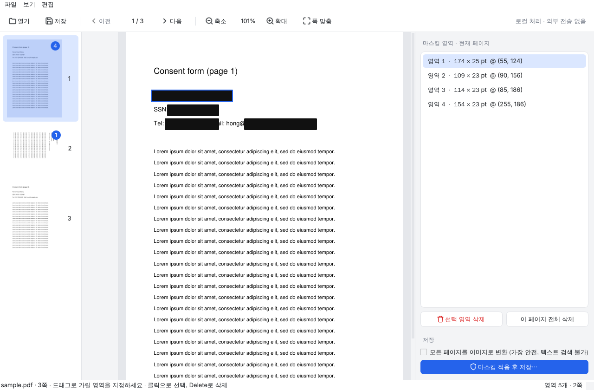
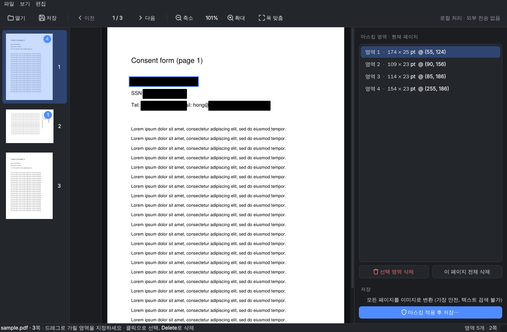

# PDF Masker

PDF에서 가릴 부분을 드래그로 지정하면 **복구할 수 없게** 지운 뒤 새 파일로 저장하는 Windows·macOS 데스크톱 앱입니다.
모든 처리는 내 컴퓨터 안에서만 이루어지며 파일이 외부로 전송되지 않습니다.

| 라이트 | 다크 |
| --- | --- |
|  |  |

## 기능

- 마우스 드래그로 가릴 영역 지정, 클릭으로 선택, `Delete`로 삭제
- 페이지 썸네일 사이드바 (마스킹 영역 수 배지 표시)
- 확대/축소 (`Ctrl` + `+`/`-`, `Ctrl`+휠), 폭 맞춤 (`Ctrl+0`)
- PDF 파일 드래그 앤 드롭으로 열기, 파일 연결로 실행 가능
- 시스템 라이트/다크 모드 자동 연동
- 암호 걸린 PDF 열기 지원 (결과는 암호 없이 저장)

## 다운로드 / 설치

GitHub Actions가 자동으로 빌드합니다. 저장소의 **Actions** 탭 → 최근 실행 → **Artifacts** 에서 받거나,
`v1.0.0` 같은 태그를 푸시하면 **Releases** 에 올라갑니다.

| 파일 | 대상 |
| --- | --- |
| `PDF-Masker-windows.exe` | Windows 10/11 (64비트) — 설치 없이 바로 실행 |
| `PDF-Masker-macos-arm64.dmg` | Apple Silicon Mac (M1 이후) |
| `PDF-Masker-macos-intel.dmg` | Intel Mac |

> **처음 실행 시 경고가 뜨는 이유**
> 개발자 서명 인증서(Apple $99/년, Windows 코드사인)를 쓰지 않아 OS가 "확인되지 않은 앱"으로 경고합니다.
> - **macOS**: 앱을 우클릭 → **열기** → 열기. (또는 시스템 설정 → 개인정보 보호 및 보안 → "그래도 열기")
> - **Windows**: SmartScreen 창에서 **추가 정보** → **실행**.
>
> 서명 인증서가 있다면 `.github/workflows/build.yml` 의 패키징 단계에 서명을 추가하면 됩니다.

## 사용법

1. PDF를 창에 끌어다 놓거나 `Ctrl+O`로 엽니다.
2. 가릴 부분을 드래그합니다. 영역을 클릭해 선택하고 `Delete`로 지울 수 있습니다.
3. `Ctrl+S`로 저장합니다. 원본은 그대로 두고 `_masked.pdf`가 새로 생깁니다.

## 복구 불가 처리 방식

단순히 검은 상자를 "덮는" 것이 아니라 내용을 **실제로 제거**합니다.

- 영역과 겹치는 텍스트 글자 삭제
- 스캔 PDF는 영역과 겹치는 이미지 픽셀 삭제
- 영역과 닿는 벡터 선/도형, 링크 제거
- 영역과 겹치는 폼 필드(입력값 포함), 주석(메모 내용 포함) 제거
- 메타데이터, 첨부파일, 숨은 텍스트 정리, 이전 리비전 제거 (증분 저장 미사용)
- 회전된 페이지(스캔본에 흔함)도 화면에서 보이는 위치 그대로 가려짐
- 옵션 "모든 페이지를 이미지로 변환": 텍스트 레이어를 통째로 없앰 (가장 안전, 검색 불가)

## 한계 · 주의

- 영역에 조금이라도 걸친 글자는 통째로 지워집니다. 저장 결과를 육안으로 확인하세요.

## 개발

```bash
python3 -m venv .venv
source .venv/bin/activate        # Windows: .venv\Scripts\activate
pip install -r requirements.txt
python main.py                   # 실행
pytest -q                        # 테스트
```

### 로컬 빌드

- macOS: `scripts/build.sh` → `dist/PDF Masker.app`
- Windows: `scripts\build.bat` → `dist\PDF Masker.exe`

### 구조

| 경로 | 역할 |
| --- | --- |
| `masker/core.py` | 마스킹 로직 (좌표 변환, 복구 불가 처리). GUI 없이 테스트 가능 |
| `masker/gui.py` | PySide6 데스크톱 UI |
| `masker/theme.py` | 라이트/다크 테마 토큰, 스타일시트, 아이콘 |
| `tests/` | 핵심 로직 테스트 14개 |
| `pdfmasker.spec` | PyInstaller 빌드 스펙 |
| `.github/workflows/build.yml` | Windows/macOS 자동 빌드 및 릴리스 |
